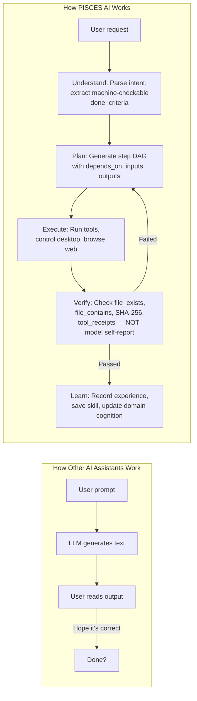
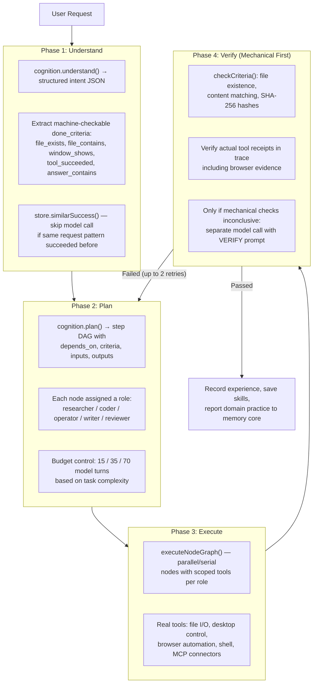
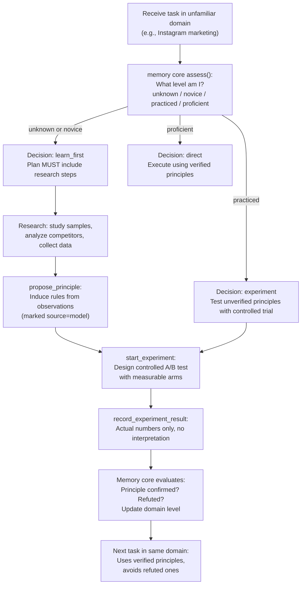
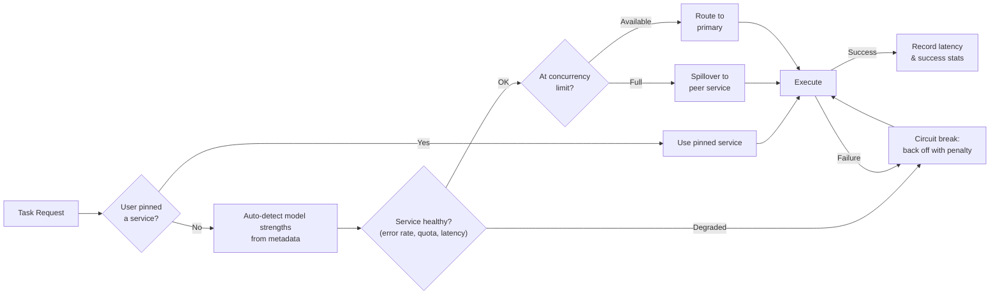
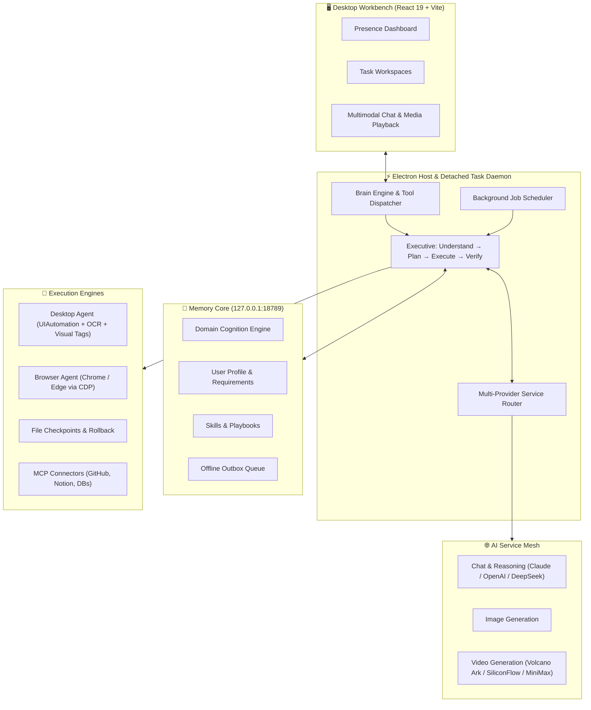
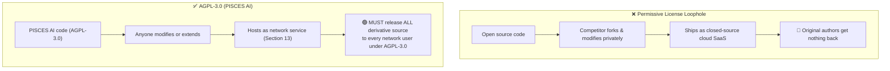

# PISCES AI

<p align="center">
  <strong>A desktop workbench where AI does real work and the core grows from real experience.</strong>
</p>

<p align="center">
  <a href="https://www.gnu.org/licenses/agpl-3.0"></a>
  
  
  
  
</p>

---

## 📖 Overview

**PISCES AI** is not a chatbot. It is a **subject** — an autonomous desktop entity that owns each task from request to mechanically verified result. The LLM is one of its tools, not its brain.

Most AI assistants today are stateless chat wrappers, sandboxed terminal bots, or ephemeral cloud agents. PISCES AI is fundamentally different: it runs as a **persistent local daemon** with lifelong memory, controls your real desktop and real browser, verifies its own work with file-system evidence, and genuinely learns your domain through structured experiments.

---

## 🚀 What Makes PISCES AI Different

### The Core Architectural Idea



> The LLM is called via `think()` for narrow, validated JSON answers. Each answer is parsed, schema-validated, and can be refused. **The executive owns decision-making, not the model.**

---

### 📊 Competitive Comparison

| | ChatGPT / Claude Web | Cursor / Devin | AutoGPT / nanoMuse | **PISCES AI** |
|:---|:---|:---|:---|:---|
| **What it is** | Stateless chat interface | Code-editing agent in IDE/terminal | Cloud-hosted agent loop | **Persistent local subject that owns tasks end-to-end** |
| **Verification** | Model says "done" (trust it?) | Code compiles / tests pass | Heuristic prompt self-check | **Mechanical file evidence: SHA-256, file_exists, file_contains, tool_receipts** |
| **Memory** | Resets each session | None across tasks | Ephemeral vector DB | **Lifelong memory core with profile, skills, playbooks, domain cognition, trajectory history** |
| **Desktop control** | None | Terminal only | Simulated browser in VM | **Real OS desktop (OCR + numbered visual tags on live UI) + real Chrome/Edge with login persistence** |
| **Background work** | Tab must stay open | Process dies on close | Cloud VM with time limits | **Detached daemon process survives window close, scheduled goals run autonomously** |
| **Learning** | Static system prompt | No learning | No learning | **Hypothesis-driven domain cognition: assess → research → propose principles → run experiments → validate** |
| **Multi-provider** | Single vendor lock-in | Single model | Manual fallback | **Auto-detection of model strengths, health-based circuit breaking, concurrency spillover** |

---

## ✨ Core Capabilities (Code-Backed)

### 1. 🔄 Understand → Plan → Execute → Verify Closed Loop

Every task goes through a **four-phase pipeline** managed by the executive (`electron/subject/executive.cjs`), not by the LLM:



**Key difference**: Verification reads back actual files and checks SHA-256 hashes. The executor's claim "I updated the file" is **never trusted** — the system independently proves it.

---

### 2. 🧠 Lifelong Memory Core with Domain Cognition

PISCES AI maintains a **dedicated local memory core** (`electron/memory.cjs`) that persists across all sessions:

**Memory types:**
- **Memories** (≤400): preferences, facts, habits, goals, lessons — each tagged and scored by relevance
- **Skills** (≤200): parameterized UI procedures with success/failure track records
- **Playbooks** (≤80): reusable multi-step procedures scored by past feedback
- **Profile**: living user document (≤4000 chars) with full undo history
- **Requirements**: long-term writing/behavior rules with revision tracking
- **Trajectories**: complete work recordings (every tool call, result, feedback) archived monthly

**Offline-resilient sync**: All changes append to a local `core-outbox.jsonl`. When the memory core server is unreachable, the outbox queues safely. On reconnection, changes replay in order — no data loss, no conflicts.

**Domain Cognition** — the system that makes PISCES AI genuinely learn:



This is not retrieval-augmented generation. The system **runs actual experiments**, records real outcomes, and builds validated domain knowledge over time.

---

### 3. 🖥️ Real Desktop Control with Visual Verification

PISCES AI controls your actual Windows desktop through `electron/desktop-agent.cjs` — a long-lived PowerShell host with .NET UIAutomation:

**Set-of-Marks visual tagging:**
- Walks the UIAutomation tree (up to 3000 elements)
- Filters to interactive elements: buttons, checkboxes, text fields, menu items, hyperlinks
- Draws **numbered colored boxes** directly on the screenshot — the model sees `[3] Save button` and says "click 3"
- Falls back to OCR (`Windows.Media.Ocr.OcrEngine`) for custom-drawn UIs (Photoshop, games) with auto-upscaling for small windows

**Closed-loop action cycle** (`control-tools.cjs`):
1. Verify target window is in foreground
2. Capture grayscale fingerprint **before** action
3. Perform action (click / type / key chord)
4. Wait for UI to settle (220ms polling, pixel-diff threshold < 0.0004)
5. Auto-follow if a dialog spawns from the same process
6. Fresh screenshot with new marks
7. Report whether the UI **actually changed**

**Anti-loop guards**: If the same action produces no effect twice in a row, the system stops and explains. After 6 consecutive no-effect actions, it forces a full stop.

**Skill replay**: Successful procedures are saved as skills. On replay, elements are matched by `type + name + automationId` — not fragile coordinates.

**Desktop input mutex**: Named mutex `PISCES.AI.DesktopInput.{SID}` ensures only one agent (or sub-agent) controls the screen at any moment.

---

### 4. 🌐 Real Browser with Login Persistence

Not a simulated browser. PISCES AI commands your actual Chrome or Edge instance via CDP (`electron/browser-runtime.cjs`):

- **Persistent sessions**: Login cookies and states survive app restarts (`persist:pisces-browser-v1`)
- Full DOM interaction: navigate, click elements, fill rich text editors, drag-and-drop, upload/download files
- **Activity journaling**: Every browser action logged to `activity.jsonl` with operation IDs
- **Uncertainty recovery**: If a tab crashes mid-operation, it's marked `uncertain: true` and requires re-observation before any new action
- Download tracking with completion status and controlled save directory

---

### 5. 👻 Persistent Background Daemon

Closing the window does **not** stop PISCES AI:

- The UI hides to **system tray** — background tasks and scheduled goals keep running
- A **detached headless Electron process** (`--task-host`) runs all jobs independently of the UI:
  ```
  spawn(process.execPath, args, { detached: true, windowsHide: true })
  child.unref()  // survives parent exit
  ```
- Background jobs support: queued → running → waiting (needs approval) → paused → done/failed
- Jobs survive restarts — interrupted jobs are flagged and can be resumed, never silently replayed
- Mid-run instruction injection: users can add instructions to a running background task
- Each job keeps up to 30 archived runs with full execution traces

---

### 6. 📋 Long-Term Goals with Autonomous Scheduling

Long-term goals (`electron/long-goals.cjs`) are not reminders — they are **autonomously executing work programs**:

- **Periodic execution**: Configurable intervals from 5 minutes to 7 days
- **File-change detection**: Watches up to 16 files; if `sourceFingerprint` hasn't changed since last run, the round is skipped entirely (zero model cost)
- **Per-goal budgets**: Daily and per-run token limits with automatic budget-day reset
- **Post-completion review**: After each round passes verification, a separate review decides what to do next round and when
- **Failure recovery**: Exponential backoff on transient failures (`interval × 2^(failureCount-1)`)
- **State machine**: active → reviewing → attention → budget → paused → stopped — with proper transitions

---

### 7. 👥 Multi-Agent Role Delegation

Complex tasks are split across specialized sub-agents (`electron/subagents.cjs`):

- **Roles**: `researcher` / `coder` / `operator` / `writer` / `reviewer` — each gets a scoped tool set
- **Automatic service matching**: Each sub-agent is routed to the best AI service for its role (vision-capable for screen work, strong reasoning for review, fast/cheap for research)
- **Screen mutex**: FIFO lock ensures only one agent controls the desktop at a time
- **Concurrency limits**: Up to 3 parallel sub-agents, 8 per conversation turn
- **Trust boundary**: Sub-agent reports are explicitly labeled "unverified information" — the parent must independently verify before telling the user

---

### 8. ⚡ Multi-Provider Routing with Circuit Breaking

`electron/service-routing.cjs` manages multiple AI services as a resilient mesh:



- **Model strength auto-recognition**: Detects coding, reasoning, vision, speed strengths from model names without manual tagging
- **Health tracking**: Continuous latency and error-rate measurement per service
- **Credit exhaustion handling**: 402/429/5xx errors trigger longer backoff; key rejection triggers service suspension
- **No silent failures**: If all services are down, the system tells the user clearly instead of retrying forever

---

### 9. 🛡️ Safety Architecture

Designed for real computer control, not demos:

- **Checkpoint rollback** (`checkpoints.cjs`): Before ANY file write, the previous content is SHA-256 hashed and backed up. Rollback refuses if the file was modified after the assistant's write — preventing accidental overwrites
- **Human-in-the-loop**: Irreversible actions (file deletion, system changes, billable media generation) pause for explicit user approval
- **Secret filtering**: Regex `/密码|密钥|口令|token|api[_ -]?key|sk-/i` — secrets are never saved to memory
- **Uncertainty quarantine**: If a tool call's result is unknown (process crashed mid-operation), it's flagged as `CORE_ACTION_UNCERTAIN` — the system never assumes success
- **Web content isolation**: Content fetched from the web is treated as data, never as instructions — preventing prompt injection from web pages

---

### 10. 📺 Presence UI — Not a Chat Interface

The home screen is called **Presence** (`src/Presence.tsx`) — a work dashboard, not a chat window:

- Heading: `"{name} is here"` — the AI has persistent presence, not a request-response cycle
- Shows: attention items, ongoing work, completed tasks, real-time activity feed
- Displays the AI's current understanding of the user: confirmed facts, preferences, learned lessons
- Dynamic status: "Today, start with one thing" / "Things are continuing" / "{n} things need you"
- "I'm going away" button puts the AI into fully autonomous background mode

---

## 🏛️ System Architecture



---

## 🛠️ Quick Start

### Prerequisites
- **OS**: Windows 10 / 11 (recommended) — macOS / Linux partial support
- **Node.js**: >= 18.0.0
- **npm**

### Install & Run

```bash
git clone https://github.com/VB-Blue/PISCES-bot.git
cd PISCES-bot
npm install

# Development
npm run dev       # Vite frontend
npm run desktop   # Build + Electron

# Production
npm run build     # Type check + build
npm run pack      # Package Windows x64 portable
npm test          # Full test suite (327 tests)
```

Or double-click `启動 PISCES AI.cmd` on Windows.

---

## 📂 Repository Structure

```text
├── electron/
│   ├── main.cjs                # Electron entry, tray daemon, task-host launcher
│   ├── subject/
│   │   ├── executive.cjs       # Core 4-phase pipeline: understand → plan → execute → verify
│   │   └── cognition.cjs       # Intent parsing, planning, verification prompts
│   ├── brain.cjs               # System prompt assembly & tool dispatch
│   ├── memory.cjs              # Lifelong memory core with outbox sync
│   ├── desktop-agent.cjs       # UIAutomation + OCR + visual tags (PowerShell host)
│   ├── control-tools.cjs       # Closed-loop desktop actions with anti-loop guards
│   ├── browser-runtime.cjs     # Chrome/Edge CDP control with session persistence
│   ├── service-routing.cjs     # Multi-provider health routing & circuit breaking
│   ├── long-goals.cjs          # Autonomous scheduled goals with file-change detection
│   ├── jobs.cjs                # Background job system (survives restarts)
│   ├── subagents.cjs           # Multi-role delegation with screen mutex
│   ├── checkpoints.cjs         # File backup & SHA-256 verified rollback
│   ├── learner.cjs             # Automatic user profile learning from behavior
│   ├── mcp.cjs                 # MCP connector integration with permission levels
│   └── ...
├── src/                        # React 19 frontend
│   ├── App.tsx                 # Workbench shell & navigation
│   ├── Presence.tsx            # Presence dashboard (not a chat window)
│   ├── WorkScene.tsx           # Live work status & activity feed
│   ├── TaskWorkspace.tsx       # Multi-modal task workspaces
│   └── ...
├── tests/                      # 327 automated tests
├── scripts/                    # Smoke tests & packaging
├── LICENSE                     # GNU AGPL-3.0
└── README.md
```

---

## ⚙️ Configuration

Open **Settings** after first launch:
- **AI Services**: Add provider endpoints, API keys, model names. Tag specializations (Code, Reasoning, Image, Video) or let auto-detection handle it.
- **Core Connection**: Memory core endpoint (default `http://127.0.0.1:18789`).
- **Native Abilities**: Authorize desktop control, browser automation, clipboard, and file access.
- **Connectors**: Add MCP servers (GitHub, Notion, databases) with per-tool permission levels (read / ask / auto).

---

## 🛡️ License (AGPL-3.0)

This project is licensed under the **[GNU Affero General Public License v3.0](LICENSE)**.



**Section 13** closes the cloud loophole: hosting a modified version as SaaS **requires full source disclosure** to all users. No closed-source clones. No free-riding.
