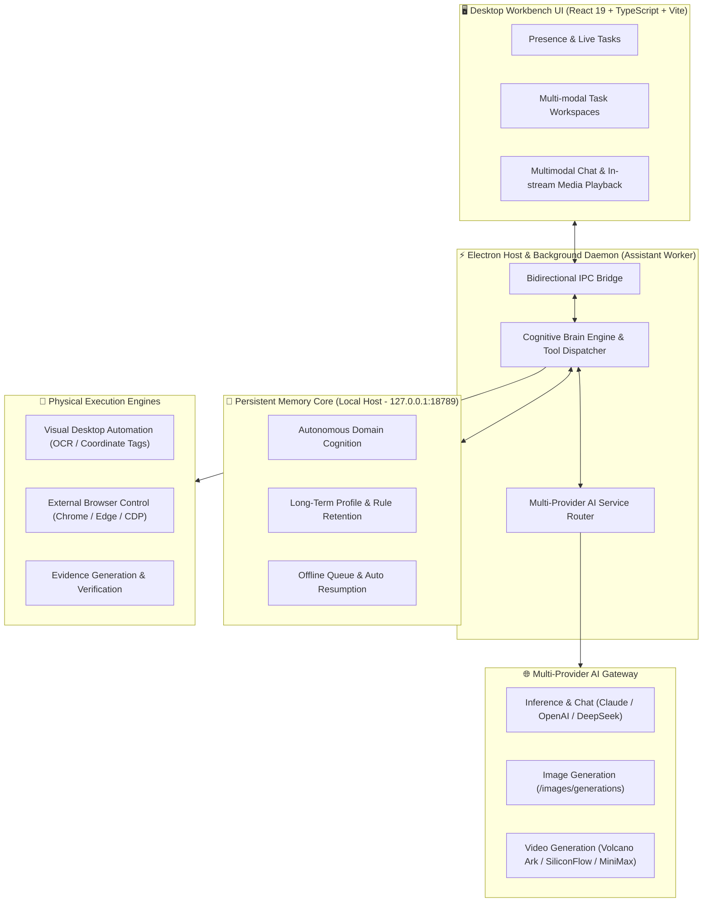
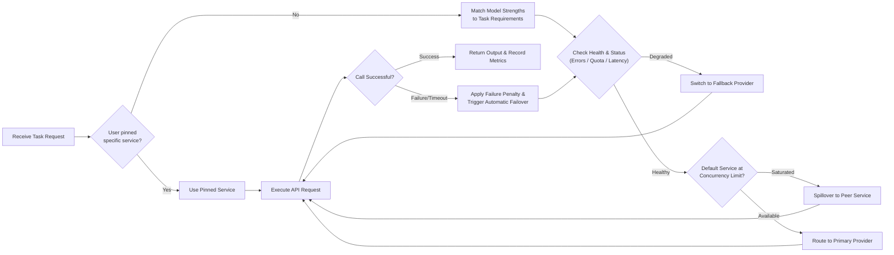

# PISCES AI

<p align="center">
  <strong>A desktop workbench where AI does real work and the core grows from real experience.</strong>
</p>

<p align="center">
  <a href="https://www.gnu.org/licenses/agpl-3.0"></a>
  
  
  
  
</p>

---

## 📖 Overview

**PISCES AI** is an advanced desktop workbench engineered for real-world autonomous productivity. Unlike ordinary chat wrappers, PISCES AI features an independent background daemon, autonomous domain cognition, a persistent memory core, and deep operating system control spanning native desktop automation and external browser manipulation.

It is purpose-built to tackle long-horizon, high-complexity tasks: decomposing multi-step goals, delegating across specialized agents, dynamically load-balancing across multi-cloud AI endpoints, and strictly verifying outcomes through physical, mechanical evidence.

---

## 🏛️ System Architecture



---

## ✨ Key Features

### 1. 🧠 Memory Core & Long-Term Retention
- **Dedicated Persistence**: User preferences, skill assets, behavior guidelines, interaction histories, and cross-session mandates are managed by a linked memory core.
- **Resilient Offline Queue**: Operations safely queue locally when disconnected, seamlessly synchronizing upon reconnection.

### 2. 🧭 Autonomous Domain Cognition
- **Self-Assessed Competence**: Before executing unfamiliar workflows, the core evaluates its knowledge depth in the relevant discipline.
- **Hypothesis-Driven Induction**: Formulates targeted learning plans, extracts sample patterns, conducts controlled tests, and consolidates verified rules into the memory core.

### 3. ⚡ Multi-Provider AI Routing & Resilience
- **Model Specialization Routing**: Intelligently routes tasks according to model strengths (coding, complex reasoning, multimodal parsing).
- **Circuit Breakers & Spillover**: Automatically avoids degraded or credit-exhausted endpoints, spilling over to secondary providers when default limits are reached.



### 4. 🎨 Multimodal Media Generation
- **Text-to-Image & Text-to-Video**: Integrates OpenAI image endpoints and major video synthesis providers (OpenAI Video, Volcano Ark, SiliconFlow, MiniMax) with background polling and automatic local storage.
- **In-Chat Rendering & Video Scrubbing**: Inline image display and draggable video playback within authorized paths.

### 5. 🖥️ Desktop Control & Browser Automation
- **Visual Desktop Execution**: Numbered overlay tags, OCR fallback, and window targeting to drive native software with mandatory human-in-the-loop approvals for sensitive operations.
- **External Browser Automation**: Full Chrome / Edge integration for precise DOM navigation, rich text input, drag-and-drop, and session persistence.

### 6. 📋 Task Workspaces & Evidence Verification
- **Dual Work Presence**: Real-time "Present" and "Working Together" dashboards for full task visibility.
- **Verifiable Deliverables**: Insists on hard file evidence for goal completion rather than accepting unsubstantiated model self-claims.

---

## 🛡️ License & Anti-Free-Riding Protection (AGPL-3.0)

This project is licensed under the **[GNU Affero General Public License v3.0 (GNU AGPL-3.0)](LICENSE)**.

```mermaid
flowchart TD
    subgraph Traditional["❌ Permissive License (MIT / BSD / Apache) Loophole"]
        P_Original["Open Source Code"] --> P_Modify["Competitor / Big Tech modifies privately"]
        P_Modify --> P_SaaS["Deploys as closed-source paid cloud SaaS"]
        P_Result["🔴 Source withheld: Community & authors are free-rided"]
        P_SaaS --> P_Result
    end

    subgraph AGPL["✅ GNU AGPL-3.0 Copyleft Protection (PISCES AI)"]
        A_Original["PISCES AI Codebase (AGPL-3.0)"] --> A_Modify["Any entity modifies or extends the code"]
        A_Modify --> A_Network["Section 13: Interacts with users over network / SaaS"]
        A_Network --> A_Mandatory["🟢 Enforces mandatory copyleft disclosure"]
        A_Mandatory --> A_Open["ALL derivative & server source code<br/>MUST be released to the public under AGPL-3.0!"]
    end
```



### Key Protective Provisions:
1. **Strong Copyleft**: Any modifications, derivative works, or integrations must also be open-sourced under the AGPL-3.0.
2. **Closing the Cloud / SaaS Loophole (Section 13)**:
   Unlike standard GPL, **AGPL-3.0 Section 13** explicitly mandates that anyone hosting a modified version as a network service (cloud SaaS, API wrapper, or remote service) **must provide the complete corresponding source code to all network users**.
3. **Anti-Plagiarism & Reciprocal Contribution**:
   Protects original research and engineering efforts against proprietary repackaging, ensuring that technological progress remains shared with the open-source community.

---

## 🛠️ Quick Start

### Prerequisites
- **Operating System**: Windows 10 / 11 (recommended) or macOS / Linux
- **Node.js**: >= 18.0.0
- **Package Manager**: npm

### Installation & Setup

1. **Clone the repository**
   ```bash
   git clone https://github.com/VB-Blue/PISCES-bot.git
   cd PISCES-bot
   ```

2. **Install dependencies**
   ```bash
   npm install
   ```

3. **Run in development mode**
   ```bash
   # Start Vite frontend
   npm run dev

   # Build frontend and launch Electron desktop application
   npm run desktop
   ```

4. **Launch via Windows script**
   - You can also double-click `启动 PISCES AI.cmd` in the project root.

### Build & Package
```bash
# Type check and build frontend
npm run build

# Package portable desktop application (Windows x64)
npm run pack
```

### Run Tests
```bash
# Execute full test suite
npm test
```

---

## 📂 Repository Structure

```text
├── electron/               # Electron main process, worker thread & automation engines
│   ├── main.cjs            # Electron entry point & lifecycle management
│   ├── assistant-worker.cjs# Main worker thread & execution pipeline
│   ├── desktop-agent.cjs   # Desktop automation, OCR & vision targeting
│   ├── brain.cjs           # System prompts, tools assembly & agent roles
│   ├── service-routing.cjs # Health checks & smart routing across AI providers
│   └── ...
├── src/                    # Modern React 19 frontend workbench
│   ├── App.tsx             # Root workbench container & view routing
│   ├── Presence.tsx        # Presence & active work views
│   ├── TaskWorkspace.tsx   # Multi-modal task workspaces
│   ├── NewWorkForm.tsx     # Task dispatch & configuration modal
│   └── ...
├── scripts/                # Smoke tests, icon generation & packaging utilities
├── tests/                  # Unit and integration test suites
├── package.json            # Package configuration and dependencies
├── LICENSE                 # Full GNU AGPL-3.0 License text
└── README.md               # Main documentation
```

---

## ⚙️ Configuration

Open **Settings** (gear icon in the lower-left corner) after first launch:
- **AI Services**: Configure provider endpoints, API keys, and model names; tag model specializations (Code, Long-form reasoning, Image, Video).
- **Core Connection**: Set memory core endpoint (default: `http://127.0.0.1:18789`).
- **Native Abilities**: Grant or review permissions for desktop control, browser automation, clipboard, and file access.

---

## 📄 License

This project is licensed under the **[GNU Affero General Public License v3.0 (GNU AGPL-3.0)](LICENSE)**. See the [LICENSE](LICENSE) file for the full text.
