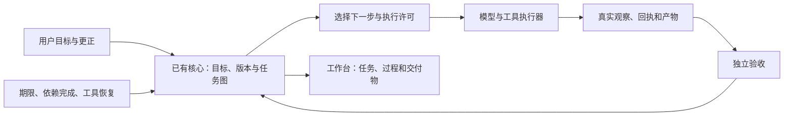

# PISCES AI 助手产品重构方案

日期：2026-10-11，Asia/Singapore。基线：桌面工程 v0.15.0。

本次交付是源码审计后的改造方案，尚未实施。审计没有启动生产应用、操作用户软件或调用付费模型；界面判断来自源码和既有验收记录，不代表完成了当前版本的实机视觉验收。

## 1. 我的判断和产品目标

用户的七点反馈指向同一个问题：PISCES AI 还没有稳定承担一件事情的全过程。用户仍然承担着启动下一步、选择工具、绑定软件、寻找状态、催促继续和判断是否完成的工作。助手把大量调度责任留给了用户。

现有代码已经具备不少基础：模型辅助理解和规划、工具执行、核心回执、后台任务、子代理、产物预览、跨会话记录，以及部分结果核对。它们的存在不能直接证明助手好用。当前主路径仍主要围绕一次对话运行，长期目标、调度、软件操作和交付没有收敛成同一条可靠的产品链。

产品目标应定为：**用户交付目标和必要约束后，PISCES AI 能在授权与预算内持续推进，主动选择方法和工具，处理失败，验证结果，并让用户随时看见工作现场。**

“自主”必须体现在实际行为中：

- 接到明确任务，自己检查环境、查找资源、开始第一步。
- 把复杂目标拆成可执行子任务，安排依赖和分工。
- 收到新要求，调整受影响的工作；保留仍有效的已完成结果。
- 遇到失败，依据观察换方法；条件没变时避免重复无效尝试。
- 到达期限、依赖完成或工具恢复时，自动唤醒该推进的任务。
- 中断后先核对现实状态，再接着做。
- 完成前检查实际交付物，完成后交付文件、证据和未解决项。
- 只在缺少关键事实、超出授权或需要人的判断时请求用户介入。

这次改造的单位是“完整任务”，每一批都交付能从目标走到结果的纵向切片。

## 2. 七个问题对应的结构性改动

| 用户反馈 | 审计发现与判断 | 必须改变的行为 |
|---|---|---|
| 没有自主性、不聪明 | 日常执行器有理解、规划、核对，但主要在单轮请求内运转；文本计划缺少调度语义 | 长期运行时持续管理目标，根据事件决定下一步 |
| 更像软件，缺少助手感 | 用户需要理解聊天、后台、持续记录、目标、桌面控制等不同入口 | 用户只交代一件事；助手负责选入口、找资源、推进和交付 |
| 不会长期编排和分配 | jobs 能定时和重复；delegate 能单次委派；日常计划没有接通完整任务图 | 子任务有依赖、输入、产物、执行者、预算和验收；主任务负责汇总 |
| 不会主动调用和控制工具 | 工具已存在，但自动发现、服务能力、窗口绑定、审批后执行仍有断点 | 自己发现能力、选择路径、打开并绑定目标，操作后重新观察 |
| UI、布局差 | 多轮样式叠加；任务、审批、执行记录和控制在不同页面 | 统一组件和布局，以工作现场组织信息与操作 |
| 对话为主，任务不可见 | “新工作”仍创建会话；四类来源聚合成任务列表；过程常收起 | 新请求直接进入稳定任务，阶段、分工、动作和产物持续可见 |
| 像个人作品 | 许多检查证明协议和页面可运行，真实模型的广泛办事能力仍缺证据 | 以实际成功率、恢复能力、可用性和可发布版本做准入 |

## 3. 现有基础与真实断点

以下位置用于开发定位；具体改动前须在实际发布的核心二进制和协议版本上复核。

| 位置 | 已有基础 | 本次要处理的断点 |
|---|---|---|
| [main.cjs](<D:/PISCES AI/electron/main.cjs:433>)、[canonical-run.cjs](<D:/PISCES AI/electron/subject/canonical-run.cjs:16>) | 普通任务与后台任务可进入同一个核心，登记理解、操作与结果 | 核心持续 work 与 jobs 调度尚未成为统一生命周期 |
| [cognition.cjs](<D:/PISCES AI/electron/subject/cognition.cjs:96>) | 计划含 do、expect、status | 没有依赖、输入输出契约、执行者、触发条件和局部失效规则 |
| [control-tools.cjs](<D:/PISCES AI/electron/control-tools.cjs:286>)、[main.cjs](<D:/PISCES AI/electron/main.cjs:693>) | update_plan 能更新界面过程 | 更新没有同步写回核心 cognition.plan，界面与持久计划可能不一致 |
| [executive.cjs](<D:/PISCES AI/electron/subject/executive.cjs:178>) | 执行后核对，失败可再规划一次 | 有限的请求内修复尚不足以管理跨天目标和局部重排 |
| [jobs.cjs](<D:/PISCES AI/electron/jobs.cjs:40>)、[scheduler.cjs](<D:/PISCES AI/electron/scheduler.cjs:26>) | 独立后台队列、定时重复、提醒 | 运行中 jobs 重启标为 interrupted，恢复仍需 resume；提醒、后台工作和目标分散 |
| [jobs.cjs](<D:/PISCES AI/electron/jobs.cjs:95>)、[main.cjs](<D:/PISCES AI/electron/main.cjs:657>) | 执行中生成压缩工作记录 | onCompact 修改传入的浅拷贝，源 jobs 对象未同步 notes，恢复记录保存需修补 |
| [subagents.cjs](<D:/PISCES AI/electron/subagents.cjs>) | 角色工具集、服务分配、并发额度、屏幕互斥 | 子代理主要返回截断文字，没有可持久续跑的子任务与产物契约 |
| [desktop_task_graph.rs](<D:/记忆体/src/desktop_task_graph.rs:100>) | 核心已有 depends_on、检查点、恢复动作、重试与主体决策边界 | 日常 cognition 计划没有编译、接入这套图；现有桌面图主要面向特定控制流程，不能直接假设覆盖全部任务 |
| [core-runtime.cjs](<D:/PISCES AI/electron/core-runtime.cjs:45>) | 核心已可作为独立后台进程启动 | 启动策略关闭 objective_auto_replan 等功能；日常模型与本机工具执行仍主要由 Electron 宿主承担 |
| [assistant-worker.cjs](<D:/PISCES AI/electron/assistant-worker.cjs:225>) | 有服务兼容降级 | 部分 HTTP 错误使工具关闭后继续对话，执行能力不足没有形成清晰的任务状态 |
| [assistant-worker.cjs](<D:/PISCES AI/electron/assistant-worker.cjs:409>) | 敏感操作可收集批准意愿，并注明尚未执行 | 获批后没有提交该高风险动作的能力；ok:true 和 not_executed 同时出现，回执语义需要收敛 |
| [assistant-worker.cjs](<D:/PISCES AI/electron/assistant-worker.cjs:368>)、[desktop-agent.cjs](<D:/PISCES AI/electron/desktop-agent.cjs:378>) | 有动作进度、超时与中止处理 | 未抛异常结果可能被记为成功；超时移除等待结果不能证明原生输入已取消，需要对账 |
| [tools.cjs](<D:/PISCES AI/electron/tools.cjs:510>)、[main.cjs](<D:/PISCES AI/electron/main.cjs:772>) | 本机通道已经能主动启动、发现和观察软件 | 另一条核心窗口通道仍要求用户预选目标；需要把已有自动能力接入一致的任务控制链 |
| [App.tsx](<D:/PISCES AI/src/App.tsx:704>)、[presenceModel.ts](<D:/PISCES AI/src/presenceModel.ts:21>) | 已有多形态工作台 | 新工作仍使用 newChat；jobs、core works、会话消息和前端记录四套来源聚合 |
| [PersistentTasksPage.tsx](<D:/PISCES AI/src/PersistentTasksPage.tsx:11>)、[GoalsPage.tsx](<D:/PISCES AI/src/GoalsPage.tsx:35>) | 可保存跟进记录、目标参考 | 创建记录不会启动任务；目标尚无完整阶段、分工和执行链 |
| [workPresentation.ts](<D:/PISCES AI/src/workPresentation.ts:45>)、[JobsPage.tsx](<D:/PISCES AI/src/JobsPage.tsx:152>) | 已有阶段显示 | 已完成 record 仍先归为跟进；暂停与中断在后台页归为已结束，语义不一致 |
| [桌面操作与成长验收](<D:/PISCES AI/桌面操作与成长验收.md>)、[多对话与多API验收](<D:/PISCES AI/多对话与多API验收.md>) | 真实 IPC、原生输入、隔离核心与并发检查 | 多数使用固定本地模型；不能据此宣布真实模型能稳定操作不同软件 |

还有一个必须验证的集成疑点：执行器可以并发 delegate，但 continuity 将 delegate 当作非只读操作；同一任务存在进行中的派发时可能拒绝另一项委派。需要真实核心集成测试确认，不能把界面上的“多代理”直接算成主任务内可靠并行。

既有[本地主体实施方案](<D:/PISCES AI/本地主体实施方案.md>)已经正确列出依赖编排、组合规划、验证与学习缺口。本方案的增量是把这些缺口映射到日常生产入口，明确迁移顺序、完整体验和发布准入。

## 4. 架构：同一个核心持有任务，执行器持续推进

### 4.1 三个职责边界

1. **已有 Rust 核心**：持有目标、任务版本、依赖图、调度决定、授权、运行状态、验收结果和恢复记录。复用当前 canonical owner、continuity、permit 和 ledger 机制。
2. **执行宿主与 worker**：提供模型、文件、浏览器、软件、连接器等执行能力。接收有边界的工作，提交观察、产物和回执；不能自己改写主任务完成状态。
3. **桌面工作台**：读取同一份已提交状态，展示工作现场并提交用户指令。聊天、通知和预览都是这件任务的入口或视图。

模型继续作为必要的理解、规划、陌生环境执行和语义审阅工具。开放任务先用能力足够的模型完成；本地规则、可靠方法和机械验证逐步接管已覆盖部分。日常成功率与本地独立能力分别报告。

新增常驻 worker 是执行宿主的迁移，不增加第二套任务主人。也不能通过全局打开现有 auto_replan 开关直接上线自主执行：必须先补齐任务范围、预算、恢复和结果验证契约。



### 4.2 扩展现有 work，形成统一任务契约

保留核心 work_id 作为任务身份，扩展协议；不要在前端新建一份有决策权的 Task 数据库。建议表示如下，字段名在协议设计时确定：

通用节点契约放在现有核心 work 内。文件、研究与模型节点分别使用执行适配器；软件节点复用 DesktopTaskGraph 的动作契约、现场指纹、完成证据和恢复机制。桌面图包含 expected_ui_state 等专用语义，需做适配，不能直接假设它就是通用任务图。调度决定仍由同一个核心持有。

| 对象 | 必要信息 | 作用 |
|---|---|---|
| 长期目标 | 结果、范围、期限、优先级、预算、用户约束、完成标准 | 任务的持续依据，可包含多个 work |
| work/任务 | 稳定 ID、目标关联、版本、状态、任务图、安排 | 不随换会话或新一轮模型调用消失 |
| 子任务节点 | 依赖、输入引用、预期产物、执行者能力、验收器、成本、重试边界 | 能判断何时可做、交给谁、何时做完 |
| run/运行 | 任务版本、节点、尝试次数、worker 租约、开始与结束原因 | 区分长期任务与一次执行尝试 |
| 动作与回执 | request_id、前状态、实际执行状态、后观察、错误分类 | 判断已做、未做、未知，支撑恢复 |
| 交付物 | 稳定 ID、版本、路径/资源、来源节点、内容摘要、验证状态 | 可打开、可对比、可重用，不依附最后一条消息 |
| 审批与等待 | 所属任务、具体动作、范围、版本、原因、恢复条件 | 用户处理后自动回到原任务 |

必须保留的约束：完成依赖才能调度；验收通过才能标完成；要求改变使受影响节点失效；旧版本或过期租约回执不能覆盖新任务；未知外部操作先核对再决定；取消后停止新派发。

状态统一为：准备、排队、执行、等待、暂停、恢复核对、验收、完成、失败、取消。等待区分“等用户”“等资源”“等时间”“等依赖”。UI 不再各自猜测状态。

### 4.3 长期运行和主动推进

用事件驱动推进任务：用户指令、期限到达、资料更新、依赖完成、worker 回执、服务恢复。定时检查只负责发现到期事件，空闲时不持续调用模型。

- 调度先筛选前提满足的节点，再考虑用户优先级、期限、资源和已排队时长。
- 文件读取、资料研究等独立节点可并行；有共享写入或前后依赖的动作串行；桌面输入继续使用全局互斥。
- 一次核心状态提交可以串行，多个已授权的独立 worker 可以在外部并行。当前 work 级派发互斥需要扩展为 node/run 级租约，绑定父任务版本、worker 身份和资源冲突键，再由同一核心签发与结算许可。不能仅把 delegate 放入只读白名单来绕过互斥。迟到回执保存现实事实，但不得完成已失效的节点。
- 模型与工具都有超时、预算、取消和失败分类。预算不足形成可解释的等待状态。
- worker 失联使租约过期，任务进入恢复核对；依据动作是否已经生效决定续跑、补验收或报告未知。
- 屏幕动作超时或取消后，原生适配器确认停止或返回最终结果前，隔离该执行通道；防止释放锁后旧输入影响另一任务。增加动作序号、截止时间、取消回执与结果查询。
- 短暂网络故障自动退避；权限不足形成具体审批；缺信息提出最关键问题；重复无进展触发诊断和换方法。
- 周期任务产生各自运行和交付物，失败不抹掉上次成功；修改周期撤销旧的未来触发。

长期执行分两步上线：第一步先让关闭窗口、切换页面、应用重开后能正确承接；第二步把日常执行宿主从窗口应用迁到独立常驻 worker，完整退出 UI 后仍能推进。电脑关机或休眠时不承诺执行，恢复后按任务规则处理错过的事件。真正后台能力必须显示当前宿主是否在线。

持久执行的设计原则可参考 Temporal 的事件历史与故障恢复说明。本项目优先在已有核心实现所需语义；是否引入外部工作流服务，留到规模与部署需求确实出现时再评估。[Temporal Workflow Execution](https://docs.temporal.io/workflow-execution)

## 5. 分配任务：以交付契约组织子代理

主任务决定是否拆分和并行。简单工作直接完成；多来源研究、跨文件修改、生成与复核等存在清晰边界时才委派。

每个子任务必须包含：目标、输入资源、允许范围、交付格式、验收标准、预算、依赖和父任务版本。子代理结果包含产物引用、证据、未完成项和需要主任务解决的问题。

主任务负责收取、核对、处理冲突、整合结果和回收失败子任务。子代理遇到资源缺失可以向主任务提交问题；它也可以由运行时暂停并续跑。不得长期只返回截断的自然语言摘要。

服务分配从“标签与正则”升级为“需求与实测能力”：工具调用、图片输入、结构化输出、长上下文、响应时间、成功率、并发和费用。用户手动指定继续优先；自动选择记录理由，并根据任务真实表现更新。连接成功不能等同于具备执行能力。

多代理界面显示“哪些子任务同时做、谁负责、依赖什么、产物到哪里”。内部角色和模型信息在详情中展开，不要求用户先选择多代理模式才能获得分工。

按需使用编排、并行和环境反馈闭环的原则，与 Anthropic 的公开工程模式一致；本方案对具体任务对象、核心权威和产品界面的安排是针对现有工程的设计判断。[Building effective agents](https://www.anthropic.com/engineering/building-effective-agents)

## 6. 工具：从能调用，做到能办成

### 6.1 工具能力登记与主动发现

每个工具登记：能做什么、参数与结果、可用条件、操作对象、权限、是否可重试、预期效果、验证方法、健康状态和适用范围。运行时根据任务需要检索并加载相关能力。

MCP 连接保留现有实现，补上按任务发现、能力变化与断线更新，保留结构化结果、图片和资源引用；不要仅将所有工具定义和裁剪文本堆进每轮模型上下文。服务声明的只读提示结合可信适配器及操作效果判断。

选择顺序是默认策略，可根据实际证据调整：已连接的领域 API/插件或可靠文件工具 → 浏览器 DOM 或软件原生接口 → UI Automation → 截图与坐标。明确需要在软件中查看或编辑时，选择能满足这个体验的路径。

用户说“把这个文件的版式改好”之后，助手自行识别文件、检查可用编辑能力、选择方式、执行、读回并预览。缺少应用或权限时，提出具体缺口；已有能力时自动使用。

### 6.2 打开、绑定、操作、验证必须连起来

软件任务执行链：

```text
识别对象 → 查询或启动应用 → 找到目标窗口/文档 → 校验绑定
→ 观察当前状态 → 选择控件或操作 → 执行 → 等待稳定
→ 重新观察 → 核对预期变化 → 继续下一步
```

用进程、窗口句柄、文档身份和当前观察绑定目标。出现多个可能目标才请用户选择。支持启动延迟、弹窗、焦点变化、缩放、多窗口和过期观察；打开软件只完成链中的一个节点。

UI Automation 工具应暴露控件实际支持的 Invoke、Value、Scroll 等模式及状态，便于选择可执行操作。某些应用控件不提供这些能力时，切换已验证的其他通道，并记录原因。[Microsoft UI Automation Control Patterns](https://learn.microsoft.com/en-us/windows/win32/winauto/uiauto-controlpatternsoverview)

两套桌面通道应共用任务、对象绑定、权限语义、观察和回执。先收口契约，再逐步收敛调用入口，保留现有可工作的适配器。

### 6.3 降低不必要的用户负担

承接任务时继承已经明确的授权。在允许目录内生成或修改可恢复的工作文件、读取资料、打开所需应用等必要步骤，按任务范围自动推进。用户能看到并撤销权限。

需要新增授权的动作集中到具体任务，说明对象、影响和范围。发送、发布、购买、破坏性操作等未获授权时，先完成可检查的前置成果，再请求最后动作的确认。审批结果绑定确切任务版本和动作；获批后走真实派发、执行和验证。

统一回执至少区分 approved、executed、verified、not_executed、unknown、failed。工具 HTTP 成功、用户批准和操作实际完成分别记录。

验收加入明确的负例：工具返回 ok:false、技能未达到后置条件、等待超时、动作后观察失败。分别进入失败或待核对，不能因为 Promise 正常返回就标完成。

服务不支持工具时优先切换到具备该能力的可用服务；仍无法执行时显示能力缺口和已保存进度。避免把执行任务静默退化为一段普通回复。

## 7. 智能：让判断和经验改变后续行动

第一阶段的智能改造落在八种可观察行为上：正确理解指代和接续；选择有价值的观察；根据约束选方法；合理分工；失败后修订假设；独立验证；复用适用经验；根据用户更正撤销旧判断。

任务上下文按工作组织，包含当前要求、有效约束、已验证产物、失败方法、未决问题和下一步条件。压缩模型上下文时保护这些内容；完整文件和大段工具结果通过资源引用取用。

复杂或已有失败的任务，可比较少量候选方法，记录前提、成本、成功依据与风险，再选择下一步。简单请求保持短路径。规划能力以结果提升衡量，不能用思考文字长度衡量。

经验保存为带条件的方法：适用对象、前提、参数、操作、验证器、成功与反例。下一次调用前重新检查前提；失败后修改适用条件或降级方法。用户明确纠正优先于历史推断。

验证分为机械检查和语义检查：文件内容与数量、表格计算、应用状态优先用独立检查器；语义要求使用证据约束的审阅。验收标准依照用户目标冻结，执行器不能自行降低标准。

同时保留本地认知研究轨：先在文件与数据两个明确领域建设参数绑定、动作组合和条件修订，利用模型示范形成候选方法，再用变化实例与反例复验。固定模型、工具、知识和预算，比较有经验、无经验和错误经验组，证明经验是否改变真实结果；零模型能力单独实验。日常助手的交付不等待这条研究轨结束。

## 8. UI：以正在推进的工作组织产品

### 8.1 信息架构

建议一级导航为：**工作台、任务、交付物、工具与应用、设置**。这是待实施的信息架构建议。

- 工作台：当前推进的工作、待处理问题、近期交付、明确的新任务入口。
- 任务：按状态、项目、期限筛选；长期目标和周期安排作为任务属性或视图。
- 交付物：按任务查找文件和结果，查看版本、预览、打开、定位和验收。
- 工具与应用：可用能力、连接状态、当前操作应用、授权范围。
- 设置：模型服务、权限、记忆管理、运行与数据配置。

全局待处理入口始终可见，包含需要用户判断、授权和补充信息的事项。聊天保留为任务沟通方式，也支持独立问答；执行型请求进入任务，闲聊不制造虚假工作。

### 8.2 工作现场布局

以下是布局规划示意，不是已实现截图：

```text
全局导航 | 任务列表        | 当前工作现场                   | 上下文（按需）
         | 正在做/等待/安排 | 目标、状态、暂停/取消/接管       | 验收标准
         | 任务与期限       | 阶段、子任务分工、当前实际动作   | 依赖与资源
         |                 | 文档/表格/网页/软件画布与产物    | 权限与证据
         |                 | 对当前任务补充要求              | 执行历史
```

中央固定呈现：目标、当前阶段、当前动作、等待原因、下一步条件、结果入口。执行计划在运行中保持可见；详细工具日志默认收起，真实里程碑和关键变化直接显示。

文档展示正文与修改对比；数据展示表格、口径和结果图；研究展示结论与来源；文件展示目录、变化和校验；软件展示目标应用、最近观察、当前动作和接管入口。复用已有画布，补全操作和证据。

审批在工作现场就地处理，也能从全局待处理进入同一个事项。批准后原任务自动继续。暂停、中断和待核对有各自含义，恢复按钮说明将检查什么。

不显示猜测的完成百分比。存在明确可验收节点时展示已验证数量，否则显示阶段和事实，例如“3 份资料已读取，1 份需要口径确认”。

### 8.3 布局与组件质量

以 Windows 桌面任务产品为设计基线，采用统一的 Fluent 2 导航和交互原则，保留 PISCES 品牌与已有可用画布；基础组件是否使用官方 React 包，由组件盘点与迁移成本决定。统一语义 token、字体、间距、控件尺寸、焦点、错误与状态反馈，明确组件样式所有权。[Fluent 2 Nav guidance](https://fluent2.microsoft.design/components/web/react/core/nav/usage/)

- 宽窗显示任务列表、画布和可选上下文；普通笔记本宽度将上下文改为抽屉。
- 小窗使用明确任务切换入口，避免隐藏列表后失去导航；主内容保留足够宽度。
- 长路径、长任务名、中文密集内容、大量记录和浅深主题都使用真实数据检查。
- 键盘能够完成选任务、查看结果、处理审批、暂停恢复；模态框管理焦点与返回位置。
- 统一空态、加载、离线、服务失败、权限不足、结果未知、完成状态。

工作台五秒可理解测试：使用者能指出“正在做什么、卡在哪里、下一步是什么、结果在哪里”。用实机观察验证，不由开发者自评。

## 9. 实施批次与开发分工

下面是依赖顺序，不是未经估算的日期承诺。先做小范围完整链，过关后扩展。

| 批次 | 具体交付 | 准入条件 |
|---|---|---|
| P0：测基线，修执行断点 | 冻结版本与模型；测用户任务；统一动作状态与失败语义；修复计划/工作记录保存；处理 toolsOff；原生取消与未知结果隔离；核查 delegate；统一状态映射 | 能指出每项失败在哪里；获批动作能执行或明确报告缺口；无虚假完成与跨任务迟到输入 |
| P1：统一任务与工作现场 | 扩展 work 协议，统一 run/子任务/产物/审批关联；新任务不再只建会话；接入一条完整任务图；任务内直接控制和审批 | 一次请求从目标到可打开结果；换页、换会话、改要求仍是同一任务 |
| P2：恢复与常驻执行 | 打通 jobs/提醒/依赖事件；租约和未知动作核对；独立 worker；周期任务与资源等待；局部重排 | 关闭 UI、执行宿主异常、网络失败后正确恢复；取消和版本更新阻止旧动作 |
| P3：可靠分工和软件操作 | 子任务产物契约；实测能力路由；自动启动与绑定；观察执行闭环；主任务整合与局部返工 | 同一主任务多个独立分工有效并行；实际软件流程可完成和复核 |
| P4：品质与经验增益 | 组件及样式收敛；冻结保留题；跨天运行；版本迁移、回滚、安装更新、诊断；方法复验 | 发布版本达到明确准入；学习效果以独立变化任务验证 |

首个开发周期先交付 P0 和 P1 的最小切片。发现工作图或恢复协议前置条件不足时，缩小首个场景，补齐主链；不通过增加独立页面绕开问题。

P0 的具体修复清单还包括：工具返回 ok:false 时不得记为成功；原生输入取消与未知结果隔离；计划更新写回核心；压缩工作记录真正持久化。对静态推断的缺陷先做定向复现，再改动，保留证明实际断点已消失的集成检查。

可以并行推进四条开发线，每条都接同一个任务契约：

| 开发线 | 主要修改区域 | 首要成果 |
|---|---|---|
| 核心与运行时 | continuity、desktop task graph、main、jobs、scheduler、执行宿主 | 同一任务生命周期、调度与恢复 |
| 工具与代理 | assistant-worker、tools、control-tools、subagents、providers、router | 可执行能力、真实回执、分工与应用闭环 |
| 产品与 UI | App、WorkScene、TaskWorkspace、presenceModel、workPresentation、组件与样式 | 任务为主的主路径与完整工作现场 |
| 验收与发布 | evals、真实模型评测、隔离核心集成、打包运行和迁移 | 同一版本的真实结果与发布准入 |

先共同冻结任务状态与事件协议，再并行实现。协议、UI 与评测必须围绕相同任务 ID 和版本联调；单线模块完成不能代替整条链验收。

## 10. 首个场景：最小切片与后续完整验收

P0/P1 的最小切片是：目录资料读取 → 销售表统计 → 报告生成 → 读回核对 → 工作台打开结果。先串行执行，使用同一个任务 ID；追加“改用销售额”后局部重做。该切片不包含常驻宿主、跨天调度、并行代理和经验增益。

后续各批继续扩展同一个场景。以下完整体验是 P2/P3/P4 的最终验收，不作为首周期全部完成的承诺。

用户提出：“把这个目录的三份资料和一张销售表整理成经营报告，明天下午给我初稿。”

1. 自行读取目录与结构，确定资料、字段、输出位置和完成标准；仅在关键口径缺失时问一个具体问题。
2. 建立同一个任务：资料提取与数据分析可并行，报告写作依赖它们完成，最终复核依赖报告产物。
3. 工作台显示各分工的输入、状态和实际产物；当前任务可以继续接收用户要求。
4. 用户补充“改用销售额、加地区比较”，更新任务版本，只失效相关统计与下游报告；有效资料提取继续复用。
5. 生成实际文档，读回数据与关键结论，检查用户要求与来源，必要时局部修订。
6. 在工具动作已经生效、回执尚未保存的边界模拟执行宿主崩溃。恢复时检查产物与前后状态，避免重复修改。
7. 到达约定时间时交付可打开文件、版本、来源与核对结果。存在缺口则说明实际已完成部分、原因和下一步。
8. 再运行变化样本，检查已验证方法是否确实减少无效步骤、提高结果可靠性。

同时做一个明确的软件控制切片：“用记事本编辑并保存指定文本，再打开确认内容”。从用户没有预选窗口的一句任务开始，助手自行发现、启动、校验必要范围授权、自动绑定、编辑、保存和验证，额外测试焦点变化与保存弹窗。该场景检验软件闭环，不代表任意软件都已覆盖。

## 11. 验收：发布成绩必须来自真实任务

### 11.1 基线与保留题

准备至少 30 项任务：文件与数据、文档与研究、软件操作、跨会话更正、跨天/中断恢复五类，每类 6 项。每类 2 项用于开发，4 项冻结为保留题。冻结应用版本、核心二进制、模型服务、任务输入和预算，保留所有失败与无效运行。

脚本化模型继续用于协议、取消、竞争和恢复测试；真实模型用于理解、工具选择、软件适应与交付成绩。两者分开报告。语义质量通过人工标准或独立审阅评判，数字和外部效果用确定性证据核对。

正式模型评测需要明确费用预算和可操作环境，不能从本次“写方案”推定为运行授权。

### 11.2 首版准入目标

以下为建议目标，不是当前成绩；基线测完可调整覆盖范围，不能事后放宽单项完成标准。

| 指标 | 首版建议门槛 |
|---|---|
| 完整任务成功 | 冻结的 20 项保留题至少 16 项完整通过；每类至少 3/4，通过范围逐项列出 |
| 无需用户教下一步 | 至少 16/20 不要求用户指定工具、页面或继续指令；必要信息与新授权单列 |
| 错误完成声明 | 评测中 0 项把未执行、未知或未验收结果说成完成 |
| 并行有效性 | 实际核心下至少两个独立子任务重叠执行；产物无串任务、遗漏或冲突 |
| 恢复 | 10 个故障注入场景都到达正确续跑或明确未知/等待状态，无重复外部副作用 |
| 更正与取消 | 旧版本动作无法继续派发；相关节点重排，已有效结果保留；在途结果单独结算 |
| 任务可见性 | 全部执行型请求有稳定任务入口，显示当前状态、实际动作、等待原因与产物 |
| 界面可用性 | 1280×720、1366×768、1920×1080 与 100%/125%/150% 缩放通过关键流程检查 |
| 时间与成本 | 每项记录耗时、调用次数、费用、重试和用户介入；与基线同条件比较，不预设虚假降幅 |

恢复样本至少覆盖：等待模型时断网、执行中 UI 重开、worker 崩溃、动作后回执前崩溃、核心暂时失联、过期租约回执、审批后要求更改、原生命令超时/取消后的迟到执行、应用焦点变化、周期任务错过触发。

小样本准入只能支持首版覆盖范围。随后扩大样本、真实软件和运行时长，报告成功比例与失败分布，不能用一次满分测试证明普遍可靠。

### 11.3 工程品质

- 一个可核对的发布版本：桌面、核心、worker、协议、模型配置和测试报告对应同一构建。
- 可迁移与回滚：旧会话、work、jobs、提醒和产物映射保留；先备份，迁移可重复执行，有版本与恢复记录。
- 迁移区分历史记录与可执行任务：用户手工记下的目标、待办只先作为记录导入，不因新版本自动获得执行授权；关联或承接后使用同一个任务契约。
- 单一权威：新运行时接通后旧调度路径转为适配或停派发，避免双执行；离线缓存只读展示并标记更新时间。
- 稳定性：隔离环境长时间运行、并发排队、资源回收、休眠唤醒、日志增长和断网恢复。
- 诊断：每个失败能关联任务、运行、动作、模型、工具和具体原因；诊断导出排除密钥和无关私人内容。
- 发布体验：安装、更新、应用退出与后台运行含义清楚；后续对外分发补齐签名与更新验证。

## 12. 立即执行的优先级

第一优先：修复“批准后仍执行不了”“工具被关闭后继续当普通聊天”“任务状态各页不同”“计划与工作记录没真正持久化”，验证并修复并行委派冲突与原生输入取消缺口。这些问题会直接破坏办事体验。

第二优先：把一个真实请求贯通为同一任务和工作现场，接入依赖、分工、产物与验收。UI 和执行链一起交付。

第三优先：常驻 worker、事件调度和恢复，使任务在用户离开页面后仍能推进，在意外中断后能正确接续。

第四优先：扩展软件覆盖和可靠方法，用真实成绩证明助手更会做事；同时收敛组件与发布流程。

验收时先展示任务如何完成，再展示内部结构。只有用户交代后能少操心、过程可见、结果可靠，这轮改造才算达到目的。
